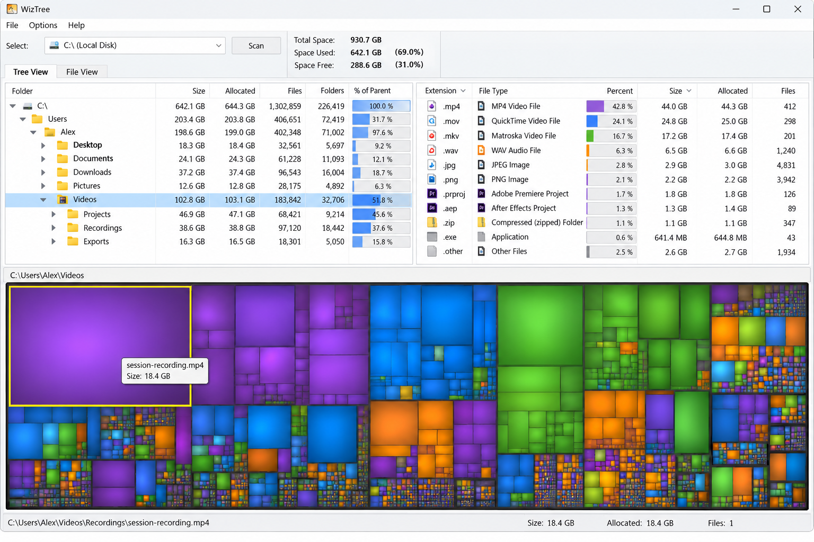
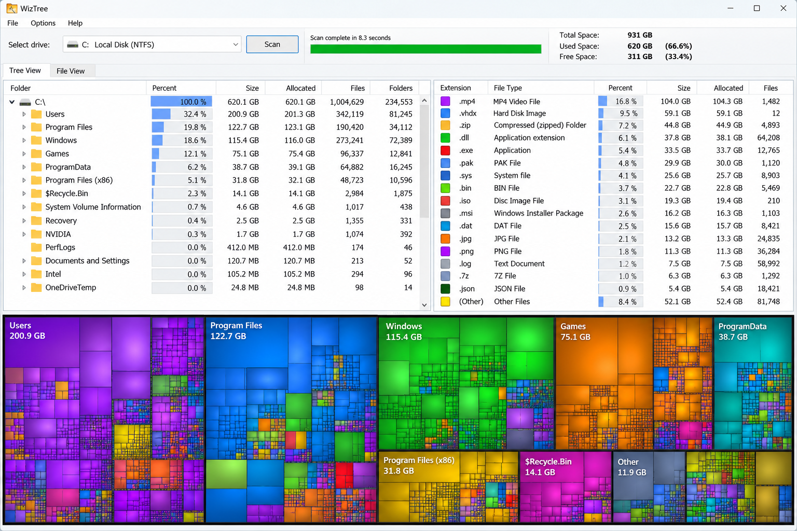
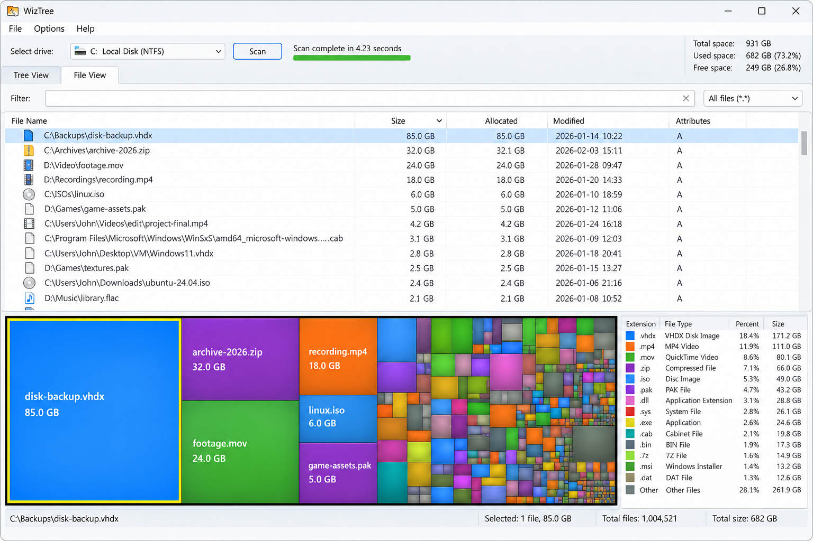

# WizTree Disk Usage Analyzer - Fast Windows Storage Visualization

## Description

WizTree Disk Usage Analyzer is a Windows desktop program from WizTree Treemap for examining drive usage through sortable file lists, directory trees, extension statistics, duplicate detection, and an interactive visual map.

The WizTree Disk Usage Analyzer codebase uses native C++ and Windows project files. Its NTFS-specific scanning path is represented by [FinderNtfs.cpp](src/FinderNtfs.cpp), while the general scanning implementation is available in [FinderBasic.cpp](src/FinderBasic.cpp).

### Major Features

- Scan Drives And Selected Directories With Dedicated NTFS And General Filesystem Readers.
- Explore Directory Totals Through A Hierarchical File Tree.
- Identify Large Files And Folders By Sorting Scanned Results.
- View Storage As Proportional Rectangles Through WizTree Treemap.
- Group And Inspect Files By Extension.
- Search Results By File Name And Apply Exclusion Rules.
- Find Duplicate Files With The WizTree Duplicate File Finder Interface.
- Bookmark Frequently Examined Locations.
- Review Items Before Running Cleanup Actions.
- Customize Settings, Views, And Dark Mode.
- Keep Scanning, Presentation, Search, And Cleanup Responsibilities Separated In Native C++ Components.

### Repository Vocabulary

wiztree disk usage analyzer, wiztree disk space analyzer, wiztree treemap, wiztree NTFS analyzer, wiztree MFT scanner, disk-space-analyzer, disk-usage, storage-analyzer, treemap, duplicate-files, disk-cleanup, storage-management, ntfs, windows

### What Is The Best Storage Manager For Windows?

The best choice depends on whether the priority is scan speed, visual exploration, duplicate detection, or cautious cleanup. WizTree Disk Usage Analyzer combines these workflows in one Windows interface, making it suitable when a user wants both a directory tree and WizTree Treemap visualization.

WizTree Windows users can inspect large items, browse extension totals, search the scanned tree, and review duplicates without switching between unrelated utilities. WizTree Windows 11 users also benefit from the native project structure, Windows resources, and dark-mode support represented in this repository.

WizTree Treemap does not make deletion decisions automatically. The user remains responsible for identifying system files, application data, caches, backups, and personal content before cleanup.

## Getting Started

1. Start WizTree Disk Usage Analyzer and choose a drive or directory.
2. Allow the scan to finish before comparing directory totals.
3. Sort the tree or file list by size to locate the largest items.
4. Select a rectangle in WizTree Treemap to locate its corresponding file or folder.
5. Open the extension view to understand which file types consume storage.
6. Use search or exclusion rules to narrow the results.
7. Run duplicate detection only when needed because file comparison can require additional reads.
8. Review every selected path before using cleanup actions.

The tree implementation is divided between [DirTree.cpp](src/DirTree.cpp), [DirTreeModel.cpp](src/DirTreeModel.cpp), and [DirTreeView.cpp](src/DirTreeView.cpp). WizTree Treemap rendering is handled by [TreeMap.cpp](src/TreeMap.cpp) and [TreeMapView.cpp](src/TreeMapView.cpp).

### How Do I Clean Up My C Drive?

Begin by scanning `C:` with WizTree Disk Usage Analyzer. Sort results by size and inspect the largest directories before selecting individual files. Use WizTree Treemap to distinguish a few unusually large files from directories containing many smaller items.

Check personal downloads, obsolete archives, old installers, temporary exports, and application caches first. Do not remove Windows, recovery, driver, package, or application directories merely because they appear large. Their contents may be required for startup, repair, updates, or installed software.

Use the WizTree Duplicate File Finder to review duplicate candidates, but verify names, paths, dates, and purpose before acting. Files with identical content may still be intentional copies used by backups or applications.

Cleanup behavior is represented by [Cleanup.cpp](src/Cleanup.cpp), [CleanupCollection.cpp](src/CleanupCollection.cpp), and [ActionManager.cpp](src/ActionManager.cpp). These components support the workflow described by the query “how to delete files with wiztree,” but safe cleanup still requires human review and a current backup.

## Installation

WizTree Portable can be used when the distributed build is packaged without a traditional installation workflow. Keep its executable and configuration together, and obtain builds only through the repository’s designated distribution entry point.

### How Can I Download WinDirStat?

This repository is named WizTree Disk Usage Analyzer and belongs to WizTree Treemap. It does not provide a separate WinDirStat download.

Names such as [WinDirStat.cpp](src/WinDirStat.cpp), [WinDirStatModel.cpp](src/WinDirStatModel.cpp), and [windirstat.sln](windirstat.sln) are retained implementation and project identifiers. They describe the source lineage and internal Windows build structure, not an additional product download.

Use the single download button in this Installation section for the application distributed by this repository. Review the application identity, version, publisher, and package integrity before running any downloaded binary.

## Copyright / Licenses

The repository terms are defined in [LICENSE](LICENSE). Review that file before copying, modifying, redistributing, or using WizTree Disk Usage Analyzer in another product.

A WizTree Commercial License associated with another distribution or vendor does not replace the terms included in this repository. Organizations evaluating commercial deployment should confirm which code, binary, and license document apply to the exact package they intend to use.

Contribution expectations are documented in [CODE_OF_CONDUCT.md](CODE_OF_CONDUCT.md), while security reporting guidance appears in [SECURITY.md](SECURITY.md).

## Compatibility

WizTree Disk Usage Analyzer targets Microsoft Windows and uses a Visual Studio solution, Windows resources, a manifest, and native C++ source files.

The repository is most relevant to:

- Windows 10.
- Windows 11.
- NTFS Volumes.
- Intel Or AMD Windows Systems Supported By The Selected Build Configuration.
- Accounts With Sufficient Permission To Read The Chosen Directories.

WizTree Linux and WizTree Android are useful search intents, but this selected repository does not contain a Linux or Android frontend. WizTree For Android would require a separate interface and platform-specific filesystem integration that are not present here.

The WizTree NTFS Analyzer path is Windows-specific. The WizTree MFT Scanner description refers to accelerated NTFS-oriented scanning behavior and should not be interpreted as support for every filesystem or operating system.

## Resources

Repository documentation and metadata include:

- [CHANGELOG.md](CHANGELOG.md) For Recorded Changes.
- [SECURITY.md](SECURITY.md) For Vulnerability Reporting.
- [CODE_OF_CONDUCT.md](CODE_OF_CONDUCT.md) For Community Expectations.
- [CONTRIBUTORS.md](CONTRIBUTORS.md) For Contributor Information.
- [LICENSE](LICENSE) For Distribution Terms.
- [README](README) For The Repository’s Retained Readme File.

The WizTree Review workflow should begin with these files and continue with inspection of the scanning, visualization, duplicate-detection, and cleanup components.

## Official Downloads And Malware Warning

Unofficial pages may reuse the WizTree name, descriptions, screenshots, or package names. A page appearing in WizTree Reddit discussions or in an “is wiztree safe” search result is not proof that its binary matches WizTree Disk Usage Analyzer.

### Can I Trust WizTree?

Trust should be based on verifiable provenance rather than branding alone. For this repository, review [SECURITY.md](SECURITY.md), inspect [LICENSE](LICENSE), examine the native source, and confirm that the binary came from the expected WizTree Treemap distribution entry point.

The scanning path is visible in [FinderNtfs.cpp](src/FinderNtfs.cpp), [FinderBasic.cpp](src/FinderBasic.cpp), and [DirReadJob.cpp](src/DirReadJob.cpp). Duplicate handling is represented by [FileDupeControl.cpp](src/FileDupeControl.cpp), while cleanup behavior can be reviewed in [Cleanup.cpp](src/Cleanup.cpp).

WizTree Disk Usage Analyzer needs access to file metadata to report storage accurately. Elevated access may reveal more of the filesystem, but it also increases the consequences of an incorrect cleanup decision. Run with only the permissions needed for the intended scan, inspect paths carefully, and maintain backups of important data.

## Building

WizTree Disk Usage Analyzer uses the Visual Studio solution [windirstat.sln](windirstat.sln) and project definition [windirstat.vcxproj](windirstat.vcxproj). Open the solution in a compatible Visual Studio C++ environment and select the required architecture and configuration.

The primary project resources are:

| Area | Files |
| --- | --- |
| Application Entry | [WinDirStat.cpp](src/WinDirStat.cpp), [WinDirStat.h](src/WinDirStat.h) |
| Main Window | [MainFrame.cpp](src/MainFrame.cpp), [MainFrame.h](src/MainFrame.h) |
| Scan Selection | [SelectDrivesDlg.cpp](src/SelectDrivesDlg.cpp), [SelectDrivesDlg.h](src/SelectDrivesDlg.h) |
| NTFS Scanning | [FinderNtfs.cpp](src/FinderNtfs.cpp), [FinderNtfs.h](src/FinderNtfs.h) |
| General Scanning | [FinderBasic.cpp](src/FinderBasic.cpp), [FinderBasic.h](src/FinderBasic.h) |
| Directory Model | [DirTreeModel.cpp](src/DirTreeModel.cpp), [DirTreeModel.h](src/DirTreeModel.h) |
| Treemap | [TreeMap.cpp](src/TreeMap.cpp), [TreeMapView.cpp](src/TreeMapView.cpp) |
| Duplicate Review | [FileDupeControl.cpp](src/FileDupeControl.cpp), [FileDupeControl.h](src/FileDupeControl.h) |
| Search | [FileSearchControl.cpp](src/FileSearchControl.cpp), [FileSearchFilter.cpp](src/FileSearchFilter.cpp) |
| Configuration | [ConfigDialog.cpp](src/ConfigDialog.cpp), [Settings.cpp](src/Settings.cpp) |
| Windows Resources | [windirstat.rc](windirstat.rc), [resource.h](resource.h), [windirstat.manifest](windirstat.manifest) |

Precompiled headers are defined by [pch.h](pch.h) and [pch.cpp](pch.cpp). Shared project properties are stored in [Project.props](Project.props), and version metadata is maintained in [version.rc](version.rc).

## Contributors

WizTree Treemap welcomes focused improvements to WizTree Disk Usage Analyzer, including scanning correctness, visualization behavior, accessibility, duplicate review, cleanup safeguards, and Windows compatibility.

Before proposing a change, keep scanning logic, model state, and presentation responsibilities separate. Test filesystem changes against ordinary files, empty directories, hard links, inaccessible paths, long names, and duplicate candidates.

See [CONTRIBUTORS.md](CONTRIBUTORS.md) for contributor information and [CODE_OF_CONDUCT.md](CODE_OF_CONDUCT.md) for participation expectations.

## Logo

